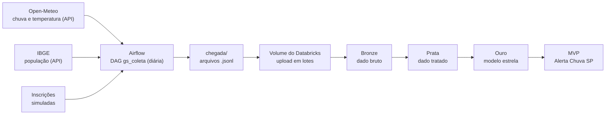

# Alerta Chuva SP

Pipeline de dados da **Global Solution FIAP 2026 · CitizenTech** (Engenharia de Software, 4º ano, 4ES),
disciplina **Big Data Architecture & Data Integration**.

> **Em uma frase:** avisar os moradores da Grande São Paulo quando vai chover forte no município onde moram,
> usando dados abertos de clima e população.

## Integrantes

| Nome completo | RM |
|---|---|
| Cassio Valezzi | 551059 |
| Gabriel Antony | 98215 |
| Lucca Sabatini | 98169 |
| Victor Nuzzi | 98209 |

## O problema

- **Cidadão e território:** quem mora nos 12 municípios da Grande São Paulo listados em `dags/municipios.csv`,
  principalmente em áreas sujeitas a alagamento.
- **Problema:** chuva forte pega o morador de surpresa, e o aviso chega tarde ou não chega.
- **Perguntas que o MVP responde ao cidadão:**
  1. Onde choveu mais e com que intensidade (nível de alerta) em cada município?
  2. Com que frequência o alerta é forte na minha cidade?
  3. Quantas pessoas vivem sob chuva e quantas inscritas receberiam o aviso (impacto)?
- **ODS conectados:** ODS 11 (cidades e comunidades sustentáveis: reduzir o impacto de desastres sobre a população),
  ODS 13 (ação contra a mudança global do clima: adaptação a eventos extremos) e ODS 3 (saúde e bem-estar: evitar
  acidentes e doenças ligados a enchentes).

## Arquitetura



O Databricks Free Edition não se conecta ao Airflow. Por isso os arquivos que o Airflow grava em `chegada/`
são enviados ao Volume pela interface do Databricks, em lotes.

## Fontes de dados

| Fonte | Origem | Formato | Frequência de coleta |
|---|---|---|---|
| Clima por hora (chuva e temperatura) | API pública Open-Meteo (Historical Forecast), sem chave | JSON, 1 linha por município | Diária (dia anterior fechado) |
| População por município | API de dados agregados do IBGE (tabela 4709, Censo 2022), sem chave | JSON, 1 linha por município | Diária (o dado muda pouco; a coleta diária mantém o fluxo) |
| Inscrições de cidadãos | **Simulada**: gerada por código (`dags/coletores.py`) com semente fixa por dia | JSON, 1 linha por inscrição | Diária |

As inscrições são **fictícias** (nomes sorteados, e-mails `@example.com`, telefones aleatórios). Cerca de 4% saem com
defeito de propósito (e-mail sem `@`, telefone curto) para a Prata mostrar as regras de qualidade barrando dados ruins.
Existem para demonstrar a proteção de dados pessoais (LGPD) sem usar pessoas reais.

## Estrutura do repositório

```
dags/            DAG do Airflow (gs_coleta.py), funções de coleta (coletores.py) e lista de municípios
databricks/      notebooks: 00_setup, 01_bronze, 02_prata, 03_ouro, 04_consultas, 05_exportar_mvp
scripts/         testar_fontes.py (teste rápido das APIs, sem Airflow)
tests/           testes automáticos (rodam sem internet, com respostas simuladas)
docs/            contrato_mvp.md (o que o MVP recebe da camada Ouro)
amostras/        um arquivo de exemplo de cada fonte
chegada/         pasta de pouso dos arquivos coletados (não vai para o Git)
docker-compose.yml   Airflow 3 local
```

## Como reproduzir o pipeline

### 1. Testar as fontes (10 segundos)

```bash
pip install requests
python scripts/testar_fontes.py
```

### 2. Subir o Airflow

```bash
docker compose up -d
```

Abra http://localhost:8080 (entra direto, sem senha, só para uso local). A DAG `gs_coleta` aparece sozinha.
No Linux/WSL, se der erro de permissão em `chegada/`, rode `chmod -R 777 chegada`.

### 3. Coletar os dados

Despause a DAG `gs_coleta`. Como `start_date` é 01/11/2026 e `catchup=True`, o Airflow cria uma execução para cada dia
desde então e continua coletando 1 dia por noite. Cada execução coleta o **dia anterior** e grava 3 arquivos em
`chegada/clima/`, `chegada/ibge/` e `chegada/inscricoes/`, com a data no nome (ex.: `clima_2026-11-10.jsonl`).

Fluxo da DAG: `inicio >> [coletar_clima, coletar_ibge, gerar_inscricoes] >> conferir_chegada >> notificar`
(as três coletas rodam em paralelo; `conferir_chegada` falha se algum arquivo faltar ou estiver vazio).

**Variables** (Admin > Variables), todas opcionais:
- `WEBHOOK_URL`: se existir, o aviso de sucesso ou falha também é enviado para esse webhook (Discord/Slack).
- `CHEGADA_DIR`: troca a pasta de pouso (padrão `/opt/airflow/chegada`).

As fontes usadas não exigem chave de API. Se um dia uma fonte exigir token, ele entra como Variable e é lido com
`Variable.get("NOME")`, nunca escrito no código.

### 4. Preparar o Databricks (Free Edition)

1. Importe a pasta `databricks/` para o seu workspace (Workspace > Import).
2. Rode `00_setup.py` (cria o schema `workspace.gs`, o Volume `chegada` e as subpastas).
3. Em **Catalog > workspace > gs > chegada**, suba os arquivos `.jsonl` de cada fonte nas subpastas `clima/`, `ibge/`
   e `inscricoes/` (**Upload to this volume**).

### 5. Bronze, em 2 lotes

1. **Lote 1:** suba só a primeira metade dos arquivos. Rode `01_bronze.py` com `rotulo = apos_lote_1`.
2. **Lote 2:** suba o restante (dias de coleta diferentes). Rode de novo com `rotulo = apos_lote_2`.
   Só os arquivos novos entram.
3. Rode uma terceira vez sem subir nada, com `rotulo = reexecucao`. Nada é duplicado.

A tabela `workspace.gs.bronze_contagens` guarda as contagens de cada execução (é a prova para o relatório).

### 6. Prata, Ouro e consultas

Rode, na ordem: `02_prata.py`, `03_ouro.sql`, `04_consultas.sql` e `05_exportar_mvp.py`.

- Prata: tipos corretos, tratamento de nulos e inválidos, `MERGE` pela chave e 3 regras de qualidade por tabela,
  com o total barrado por regra em `workspace.gs.prata_qualidade`.
- Ouro: modelo estrela com `fato_chuva_dia` e as dimensões `dim_municipio`, `dim_data`, `dim_nivel_alerta` e
  `dim_inscrito` (dados pessoais protegidos), mais a tabela `ouro_painel_alerta`, que o MVP usa.
- `04_consultas.sql`: 5 consultas SQL sobre as perguntas do MVP, a quinta é a de impacto.

## LGPD

Na Ouro, nenhum dado pessoal aparece como veio: nome vira primeiro nome + inicial (`Ana S.`), e-mail vira hash SHA-256
e telefone é mascarado (`(11) *****-1234`). O arquivo que o MVP recebe (`ouro_painel_alerta`) só tem dados agregados.
Os dados originais são fictícios.

## Testes

```bash
pip install -r requirements-dev.txt
pytest tests
```

